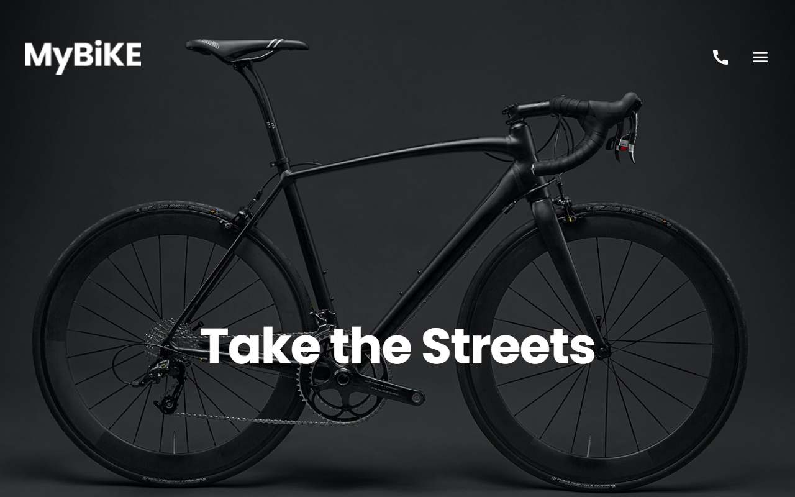

# My Bike – landing page

Responsive multi-section landing page for a bike shop, built according to a Figma design.

**[▶ Live demo](https://natakovbasniuk.github.io/layout_landing-page/)** · [Figma mockup](https://www.figma.com/design/NZQAIydtHo5QkINyGLHNcq/BIKE-New-Version?node-id=41317-189&t=0bbjUTutuwPDSrBO-0)



## What I implemented
- Page sections: hero, bike comparison cards, product details
- Responsive layout following the Figma design
- Markup structured with the BEM methodology, styles in SCSS
- Small interactive parts in JavaScript

## Tech stack
HTML5, SCSS, BEM, Flexbox, JavaScript, Figma

## Run locally
```bash
git clone https://github.com/NataKovbasniuk/layout_landing-page.git
cd layout_landing-page
npm install
npm start          # http://localhost:8080
```

---
Course project at [Mate Academy](https://mate.academy): the design was provided by the course, the markup, styles and scripts are my implementation.
